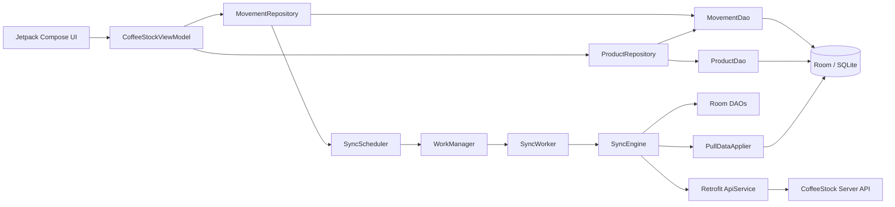

# D3. Mã nguồn ứng dụng Android

Tài liệu giới thiệu ứng dụng CoffeeStock trên Android, các lớp chính trong kiến trúc Kotlin và hướng dẫn cấu hình, build, cài đặt, chạy ứng dụng.

## 1. Minh chứng Repository

- **Repository:** [524h0007-TranHuuDanh/PhatTrienUngDungDiDongN12](https://github.com/524h0007-TranHuuDanh/PhatTrienUngDungDiDongN12)
- **Nhánh:** `main`
- **Quyền truy cập:** Public
- **Thư mục ứng dụng Android:** `app/` tại thư mục gốc repository
- **Mã nguồn Kotlin chính:** `app/src/main/java/com/example/coffeestock/`

## 2. Công nghệ và cấu trúc mã nguồn

Ứng dụng viết bằng Kotlin, dùng Jetpack Compose/Material 3 cho giao diện và kiến trúc phân lớp để tách UI, state, nghiệp vụ dữ liệu và tích hợp backend.

| Thành phần | Công nghệ/vai trò |
|---|---|
| Giao diện | Jetpack Compose, Material 3, hiển thị dashboard, kho hàng, phiếu kho |
| Trạng thái UI | `CoffeeStockViewModel`, `StateFlow`, `collectAsStateWithLifecycle` |
| Dữ liệu cục bộ | Room, SQLite; database hiện ở version 3 |
| Repository | `MovementRepository`, `ProductRepository` |
| Kết nối server | Retrofit, Gson; API push/pull |
| Đồng bộ nền | WorkManager, unique work, network constraint, exponential backoff |
| Ngôn ngữ/công cụ build | Kotlin `2.3.21`, Android Gradle Plugin `9.4.1`, Gradle Wrapper `9.6.0` |
| SDK | `compileSdk 37`, `targetSdk 37`, `minSdk 24` |

### Các lớp chính

| Đường dẫn | Trách nhiệm |
|---|---|
| `app/src/main/java/com/example/coffeestock/MainActivity.kt` | Khởi tạo Room, repository, ViewModel, seed sản phẩm lần đầu, enqueue đồng bộ và mở Compose UI |
| `app/src/main/java/com/example/coffeestock/ui/MainScreen.kt` | Giao diện Compose, các tab Tổng quan/Kho hàng/Phiếu kho và trạng thái đồng bộ |
| `app/src/main/java/com/example/coffeestock/viewmodel/CoffeeStockViewModel.kt` | Tổng hợp dữ liệu thành `CoffeeStockUiState`, chuyển thao tác UI đến repository |
| `app/src/main/java/com/example/coffeestock/data/repository/MovementRepository.kt` | Tạo/sửa/xác nhận/xóa phiếu; ghi thay đổi local và lên lịch đồng bộ |
| `app/src/main/java/com/example/coffeestock/data/repository/ProductRepository.kt` | Đọc sản phẩm và tính tồn kho từ các phiếu đã xác nhận |
| `app/src/main/java/com/example/coffeestock/data/local/AppDatabase.kt` | Cấu hình Room database, entities, migrations |
| `app/src/main/java/com/example/coffeestock/data/local/entity/` | Entity sản phẩm, phiếu kho, log xung đột và metadata đồng bộ |
| `app/src/main/java/com/example/coffeestock/data/local/dao/` | Truy vấn Room cho sản phẩm, phiếu và metadata |
| `app/src/main/java/com/example/coffeestock/data/remote/ApiService.kt` | Khai báo endpoint đồng bộ Retrofit |
| `app/src/main/java/com/example/coffeestock/data/remote/RetrofitClient.kt` | Tạo Retrofit client từ cấu hình build |
| `app/src/main/java/com/example/coffeestock/sync/` | Sync engine, pull applier, conflict resolver, scheduler và worker |

## 3. Luồng dữ liệu và giao diện



- UI quan sát `StateFlow` từ ViewModel; dữ liệu sản phẩm, phiếu và số lượng chờ/thất bại/xung đột được cập nhật theo luồng dữ liệu Room.
- Tạo/sửa/xác nhận/xóa phiếu được lưu local trước. Repository đặt trạng thái đồng bộ và yêu cầu WorkManager chạy khi có mạng.
- Worker gọi `SyncEngine` để push các mutation local và pull các thay đổi server vào Room.
- Khi không có mạng, dữ liệu local vẫn có thể được giữ trong Room; WorkManager xử lý yêu cầu đồng bộ theo điều kiện mạng.
- Danh sách sản phẩm mẫu (Arabica, Robusta, Culi) được thêm bằng `ProductSeeder` nếu bảng sản phẩm đang rỗng.

### Trạng thái hiển thị

Thanh trạng thái trên đầu giao diện thể hiện tình trạng WorkManager: đang chờ điều kiện, đang chờ tác vụ trước, đang đồng bộ, thành công, thất bại, bị hủy hoặc chưa có tác vụ. UI cũng hiển thị số phiếu chờ đồng bộ, số thất bại, số xung đột và nút **Đồng bộ ngay**.

Trên từng phiếu, ứng dụng hiển thị trạng thái nghiệp vụ (nháp/đã xác nhận) và trạng thái đồng bộ: chờ, đang đồng bộ, đã đồng bộ, thất bại hoặc xung đột.

## 4. Cấu hình kết nối backend

Từ thư mục gốc repository, tạo file cấu hình riêng cho máy phát triển:

**Windows PowerShell:**
```powershell
Copy-Item local.properties.example local.properties
```

**Linux/macOS:**
```bash
cp local.properties.example local.properties
```

Kiểm tra các giá trị trong `local.properties` khớp với `API_KEY` của server:

```properties
COFFEESTOCK_API_BASE_URL=http://127.0.0.1:8080/
COFFEESTOCK_API_KEY=coffeestock-dev-key
```

- Với Android Emulator, cấu hình mẫu dùng `127.0.0.1` cùng `adb reverse tcp:8080 tcp:8080`.
- Với thiết bị thật, đổi URL thành địa chỉ LAN của máy chạy backend, ví dụ `http://192.168.1.10:8080/`; hai thiết bị cần cùng mạng và firewall cho phép truy cập.
- Android Studio thường tự cấu hình `sdk.dir`. Nếu build bằng command line mà Gradle không tìm được Android SDK, thêm đường dẫn SDK vào `local.properties` hoặc cấu hình `ANDROID_HOME`.
- `local.properties` đã được Git ignore; không commit API key, cấu hình máy hoặc secret thật.

## 5. Build, cài đặt và chạy

### Yêu cầu

- Android Studio Ladybug 2024.2 trở lên, JDK 17+.
- Android SDK Platform 37 và Platform-Tools.
- Emulator hoặc thiết bị Android 7.0 (API 24) trở lên.
- Node.js server đang chạy nếu cần kiểm tra đồng bộ online; xem [D4. Mã nguồn máy chủ và API](./D4_SERVER_API.md).

Mở repository bằng Android Studio hoặc chạy lệnh từ thư mục gốc.

### Build debug APK

**Windows:**
```powershell
.\gradlew.bat :app:assembleDebug
```

**Linux/macOS:**
```bash
./gradlew :app:assembleDebug
```

APK được tạo tại `app/build/outputs/apk/debug/app-debug.apk`.

### Cài và chạy trên emulator/thiết bị

Khởi động emulator hoặc bật USB debugging trên thiết bị; xác nhận kết nối:
```bash
adb devices
```

Cài debug build:

**Windows:**
```powershell
.\gradlew.bat :app:installDebug
```

**Linux/macOS:**
```bash
./gradlew :app:installDebug
```

Gradle tự gọi task `adbReverse` khi cài debug build. Có thể mở app từ Android Studio bằng **Run `MainActivity`**, hoặc khởi chạy bằng ADB:
```bash
adb shell am start -n com.example.coffeestock/.MainActivity
```

### Chạy test Android

Unit test JVM, không cần emulator:

```powershell
.\gradlew.bat :app:testDebugUnitTest
```

Instrumentation test, cần emulator/thiết bị đang kết nối:
```powershell
.\gradlew.bat :app:connectedDebugAndroidTest
```

Kết quả và test cases cụ thể được ghi trong [D6. Bộ kiểm thử và kết quả kiểm thử](./D6_TEST_RESULTS.md).

## 6. Minh chứng liên quan

- Mã nguồn Android: `app/src/main/`
- Cấu hình dependencies Android: `app/build.gradle.kts`, `gradle/libs.versions.toml`
- File mẫu cấu hình SDK/backend: `local.properties.example`
- Hướng dẫn build và chạy toàn repository: [README.md](../README.md)
- Mô tả đồng bộ và xung đột: [D5. Mô-đun đồng bộ và xử lý xung đột](./D5_SYNC_CONFLICTS.md)
- Kết quả kiểm thử Android: [D6. Bộ kiểm thử và kết quả kiểm thử](./D6_TEST_RESULTS.md)
