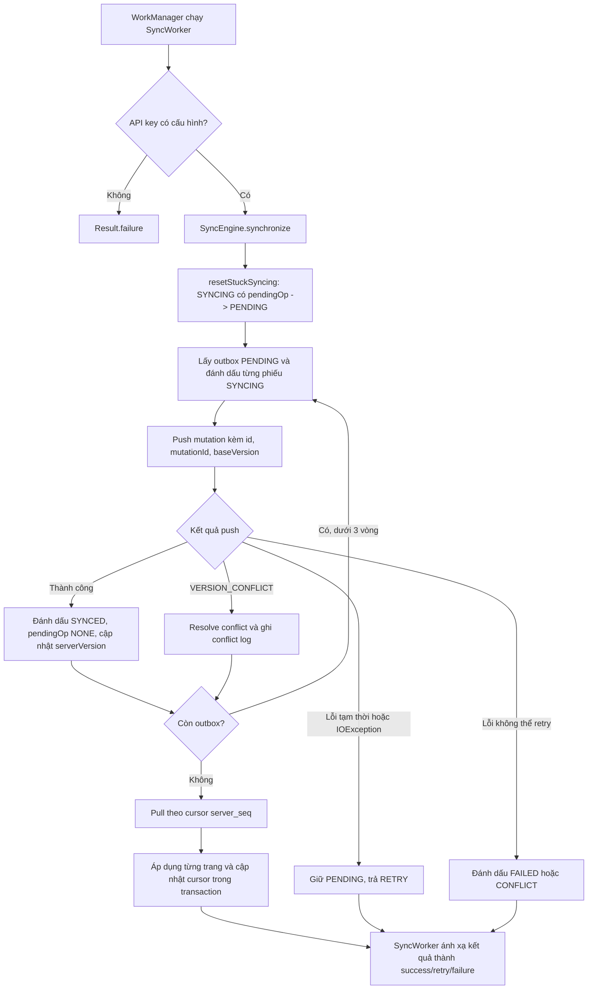

# D5. Mô-đun đồng bộ và xử lý xung đột

Tài liệu mô tả cách CoffeeStock theo dõi thay đổi cục bộ, đồng bộ hai chiều với server, xử lý xóa logic, retry, tránh áp dụng mutation lặp và giải quyết xung đột giữa nhiều thiết bị.

## 1. Mã nguồn liên quan

| Thành phần | Vị trí |
|---|---|
| Điều phối push/pull, recovery và xử lý HTTP | `app/src/main/java/com/example/coffeestock/sync/SyncEngine.kt` |
| Chính sách quyết định khi có xung đột | `app/src/main/java/com/example/coffeestock/sync/ConflictResolver.kt` |
| Áp dụng trang pull và lưu cursor | `app/src/main/java/com/example/coffeestock/sync/PullDataApplier.kt` |
| Worker chạy nền, retry và giới hạn lần thử | `app/src/main/java/com/example/coffeestock/sync/SyncWorker.kt` |
| Lên lịch unique work | `app/src/main/java/com/example/coffeestock/sync/SyncScheduler.kt` |
| Trạng thái phiếu cục bộ | `app/src/main/java/com/example/coffeestock/data/local/entity/MovementEntity.kt` |
| Truy vấn outbox và cập nhật trạng thái | `app/src/main/java/com/example/coffeestock/data/local/dao/MovementDao.kt` |
| Tạo/sửa/xóa phiếu và đánh dấu thay đổi local | `app/src/main/java/com/example/coffeestock/data/repository/MovementRepository.kt` |
| Quy tắc version, idempotency, cursor trên server | `server/src/modules/sync/sync.service.js`, `server/src/modules/sync/sync.repository.js` |

## 2. Cách theo dõi thay đổi cục bộ

Mỗi `MovementEntity` lưu dữ liệu nghiệp vụ cùng các trường đồng bộ:

| Trường | Vai trò |
|---|---|
| `id` | ID ổn định của phiếu, được dùng làm khóa trên client và server |
| `serverVersion` | Version server gần nhất mà client đã nhận; dùng làm `base_version` khi push |
| `localRev` | Tăng khi nội dung phiếu thay đổi cục bộ; giúp nhận diện chỉnh sửa phát sinh trong lúc request đang chạy |
| `mutationId` | UUID của mutation hiện tại; đổi khi có thao tác local mới và giữ ổn định khi retry mutation đó |
| `pendingOp` | `CREATE`, `UPDATE`, `DELETE` hoặc `NONE` |
| `syncState` | `PENDING`, `SYNCING`, `SYNCED`, `FAILED` hoặc `CONFLICT` |
| `isDeleted` | Tombstone/xóa mềm phía client |

Luồng tại repository:

- Tạo phiếu mới: `serverVersion = 0`, `pendingOp = CREATE`, `syncState = PENDING`.
- Sửa phiếu: tăng `localRev`, cấp `mutationId` mới và đặt `PENDING`; thao tác là `CREATE` nếu chưa từng có trên server, nếu không là `UPDATE`.
- Xóa phiếu chưa từng đồng bộ (`serverVersion = 0`): xóa bản ghi local ngay, không cần gửi server.
- Xóa phiếu đã có trên server: giữ bản ghi local dưới dạng tombstone (`isDeleted = true`, `pendingOp = DELETE`, `syncState = PENDING`) để push.
- Khi dữ liệu local thay đổi trong lúc push, kết quả response chỉ cập nhật đúng revision/mutation đã gửi. Nếu revision đã đổi, client nhận version server mới nhưng bảo toàn thay đổi local để gửi tiếp.

## 3. Thuật toán đồng bộ hai chiều

`SyncWorker` được WorkManager gọi khi có kết nối mạng. `SyncScheduler` đặt các yêu cầu cùng tên `coffeestock_sync` với policy `APPEND_OR_REPLACE`: các lần yêu cầu dùng chung một chuỗi công việc và được xử lý theo lượt, không bị coi là gộp thành một request.



### 3.1. Push

1. Trước khi đồng bộ, `resetStuckSyncing()` đưa các phiếu còn `SYNCING` và `pendingOp != NONE` trở lại `PENDING`. Đây là recovery cho worker/process bị dừng khi request đang xử lý.
2. Outbox lấy các phiếu `PENDING` có thao tác cần gửi. Trước request, mỗi phiếu được đánh dấu `SYNCING` với điều kiện ID, `localRev` và `mutationId` vẫn khớp.
3. Ứng dụng hiện gửi từng movement trong một request push riêng, dù API server nhận batch tối đa 100 item. Client gửi `id`, `operation`, `mutation_id`, `base_version` lấy từ `serverVersion`, `local_rev` và payload.
4. Thành công: lưu trạng thái đã đồng bộ và `serverVersion` server trả về; nếu local đã được sửa mới hơn trong lúc chờ, giữ thay đổi local và tiếp tục đồng bộ với version server vừa nhận.
5. `SyncEngine.synchronize()` chạy tối đa 3 vòng push để xử lý outbox phát sinh tiếp; nếu vẫn còn outbox sau đó, trả `RETRY`.

### 3.2. Pull

- Client đọc cursor `movements_last_seq` từ `sync_meta`; mặc định là `0`.
- Mỗi request pull lấy tối đa 100 thay đổi sau cursor. Nếu server báo còn trang (`hasMore`), client tiếp tục cho đến khi hết.
- Mỗi trang được áp dụng trong Room transaction cùng thao tác lưu cursor. Cursor không được phép giảm; khi server báo còn trang nhưng cursor không tiến, đồng bộ thất bại để tránh lặp vô hạn.
- Phiếu local có `pendingOp != NONE` không bị ghi đè bởi pull. Thay đổi sẽ được xử lý sau khi outbox được đẩy.
- Thay đổi từ server được thêm/cập nhật thành `SYNCED`, `pendingOp = NONE`. Tombstone server xóa bản ghi local đã đồng bộ nếu version server mới hơn.

## 4. Retry và phục hồi

### Lỗi có thể thử lại

- Lỗi mạng `IOException` khi push/pull.
- HTTP `408`, `429` và `5xx`.
- Một số mã lỗi nghiệp vụ tạm thời: `RATE_LIMITED`, `TEMPORARY_UNAVAILABLE`, `SERVER_ERROR`, `TIMEOUT`.
- Response push thành công nhưng thiếu kết quả tương ứng với mutation.
- Outbox vẫn còn sau số vòng push nội bộ.

Với lỗi tạm thời, phiếu được đưa lại `PENDING`; `SyncEngine` trả `SyncResult.RETRY`. `SyncWorker` trả `Result.retry()` trước giới hạn 5 lần thử. Scheduler cấu hình backoff exponential, bắt đầu 30 giây.

Lỗi validation/vĩnh viễn được đánh dấu `FAILED`; xung đột có thông tin server được phân giải hoặc lưu trạng thái `CONFLICT`. `SyncWorker` trả `Result.failure()` khi lỗi không retry được, API key trống, hoặc đã chạm lần thử thứ 5.

### Khôi phục worker bị dừng

Nếu worker bị kill sau khi đã ghi `SYNCING` nhưng trước khi cập nhật kết quả, dữ liệu local vẫn còn. Lượt đồng bộ kế tiếp gọi `resetStuckSyncing()` trước khi đọc outbox, chuyển các phiếu `SYNCING` còn thao tác chờ thành `PENDING`, rồi gửi lại. Tính idempotent phía server bảo vệ trường hợp request trước thực tế đã được server xử lý nhưng client chưa nhận response.

## 5. Tránh gửi trùng và xử lý phiên bản

Hai cơ chế phối hợp:

1. **Idempotency:** Mỗi mutation có `mutationId` ổn định. Server lưu response thành công trong `idempotency_records` theo mutation ID. Gửi lại cùng mutation ID trả response đã lưu thay vì áp dụng mutation lần nữa. Khi người dùng sửa/xóa tiếp, repository tạo mutation ID mới.
2. **Optimistic locking:** `base_version` phải bằng version hiện tại trên server. Nếu khác, server trả `VERSION_CONFLICT` cùng trạng thái phiếu hiện hành; server không âm thầm ghi đè thay đổi cạnh tranh.

ID bản ghi (`id`) xác định phiếu; mutation ID xác định một lần thay đổi lên phiếu. `serverVersion` phát hiện stale write, còn `server_seq` xác định thứ tự thay đổi dùng cho pull cursor.

## 6. Chính sách xử lý xung đột

`ConflictResolver` áp dụng các nhánh theo đúng thứ tự sau:

| Thứ tự | Điều kiện | Quyết định | Kết quả |
|---|---|---|---|
| 1 | Server đã xóa (`server.isDeleted`) | `KEEP_SERVER` | Giữ trạng thái xóa server |
| 2 | Server đã `CONFIRMED` | `KEEP_SERVER` | Giữ dữ liệu server; ưu tiên này cao hơn cả local đang yêu cầu xóa |
| 3 | Local đã xóa hoặc `pendingOp = DELETE` | `RETRY_LOCAL_DELETE` | Giữ yêu cầu xóa local, cập nhật version server rồi gửi lại |
| 4 | Local `CONFIRMED`, server chưa xác nhận | `RETRY_LOCAL` | Giữ local và gửi lại trên version mới |
| 5 | Cả hai còn lại (ví dụ cùng `DRAFT`) | `RETRY_LOCAL` | Giữ thay đổi local, cập nhật version server và retry |

Quyết định cùng snapshot local/server, version và thời gian được ghi vào bảng conflict trong transaction. Khi chọn `KEEP_SERVER`, client thay dữ liệu bằng server hoặc xóa cứng local nếu server là tombstone. Khi chọn retry local, client cập nhật version nền và đưa mutation hiện tại về `PENDING`; `mutationId` hiện tại được giữ nguyên.

Đây là chính sách ưu tiên được mã hóa sẵn, không phải màn hình yêu cầu người dùng chọn thủ công.

## 7. Ví dụ minh họa

### Ví dụ A — Hai thiết bị cùng sửa phiếu nháp

1. Server đang ở version 1. Thiết bị A sửa số lượng thành 15 và push `base_version = 1`; server chấp nhận, thành version 2.
2. Thiết bị B sửa cùng phiếu thành số lượng 25 nhưng vẫn có `base_version = 1`.
3. Server trả `VERSION_CONFLICT`, kèm bản hiện hành version 2.
4. `ConflictResolver` thấy server và local đều là nháp, chọn `RETRY_LOCAL`.
5. Thiết bị B ghi conflict log, giữ số lượng 25, cập nhật `serverVersion = 2` và đưa cùng mutation về `PENDING` để gửi lại trên version mới.
6. Server chấp nhận thành version 3. Thiết bị B kết thúc `SYNCED`, `pendingOp = NONE`.

Test minh chứng: `MultiDeviceConflictTest.tc07_twoDevices_conflictAndResolution`.

### Ví dụ B — Server đã xác nhận, local vẫn chỉnh sửa

Server trả phiếu `CONFIRMED` trong response conflict. Nhánh ưu tiên server xác nhận chọn `KEEP_SERVER`; client thay dữ liệu local bằng bản server, không retry bản nháp cũ.

Test chính sách: `ConflictResolverTest.serverConfirmed_shouldKeepServer`.

### Ví dụ C — Local xóa, server vừa cập nhật

Local gửi `DELETE` trên version cũ, server báo conflict nhưng bản hiện hành vẫn chưa xóa và chưa xác nhận. Resolver chọn `RETRY_LOCAL_DELETE`; cập nhật version nền rồi gửi lại yêu cầu xóa. Khi thành công, server tạo tombstone với version/sequence mới; các client khác nhận tombstone qua pull.

Test minh chứng: `MultiDeviceConflictEdgeTest.tc12_editVsDelete_localDeleteRetriesAndWins`.

### Ví dụ D — Server xóa trong khi local sửa

Server trả tombstone. Nhánh đầu tiên chọn `KEEP_SERVER`, lưu conflict log và xóa cứng bản local đang xung đột; chỉnh sửa cũ không được hồi sinh phiếu đã bị xóa trên server.

Test minh chứng: `MultiDeviceConflictEdgeTest.tc11_deleteVsEdit_serverDeleteWins`.

### Ví dụ E — Mất mạng hoặc worker bị dừng

- Mất mạng khi push: movement được đưa lại `PENDING`, worker yêu cầu retry.
- Worker bị kill sau khi movement chuyển `SYNCING`: lượt kế tiếp chạy `resetStuckSyncing()`, đưa movement về `PENDING`, rồi gửi lại cùng mutation ID.
- Nếu server đã xử lý request cũ, idempotency trả lại kết quả đã lưu; không tạo thêm mutation.

Test minh chứng: `SyncEngineTest.pushNetworkFailureReturnsRetryAndRestoresPendingState`, `SyncEngineTest.synchronize_recoversMovementLeftSyncingByInterruptedWorker` và `SyncEngineTest.resetStuckSyncing_requeuesOnlyMovementsWithPendingOperations`.

## 8. Test minh chứng

| Phạm vi | Test |
|---|---|
| Các nhánh chính sách conflict | `app/src/test/java/com/example/coffeestock/sync/ConflictResolverTest.kt` |
| Đồng bộ hai thiết bị, stale version và retry local | `app/src/androidTest/java/com/example/coffeestock/sync/MultiDeviceConflictTest.kt` |
| Xóa-vs-sửa, xóa local-vs-cập nhật server và cạnh biên | `app/src/androidTest/java/com/example/coffeestock/sync/MultiDeviceConflictEdgeTest.kt` |
| Retry mạng, recovery worker bị dừng, reset stuck state | `app/src/androidTest/java/com/example/coffeestock/sync/SyncEngineTest.kt` |
| HTTP lỗi khi push | `app/src/androidTest/java/com/example/coffeestock/sync/PushHttpErrorTest.kt` |
| Push/pull và idempotency phía server | `server/tests/sync.integration.test.js` |

Chạy unit test resolver từ thư mục gốc:

```powershell
.\gradlew.bat :app:testDebugUnitTest --tests com.example.coffeestock.sync.ConflictResolverTest
```

Chạy nhóm test instrumentation sync với emulator đang hoạt động:

```powershell
.\gradlew.bat :app:connectedDebugAndroidTest "-Pandroid.testInstrumentationRunnerArguments.package=com.example.coffeestock.sync"
```

Chạy integration test backend từ thư mục `server/`:

```bash
npm test
```

## 9. Tài liệu liên quan

- [D4. Mã nguồn máy chủ và API](./D4_SERVER_API.md)
- [README và hướng dẫn build/chạy dự án](../README.md)
