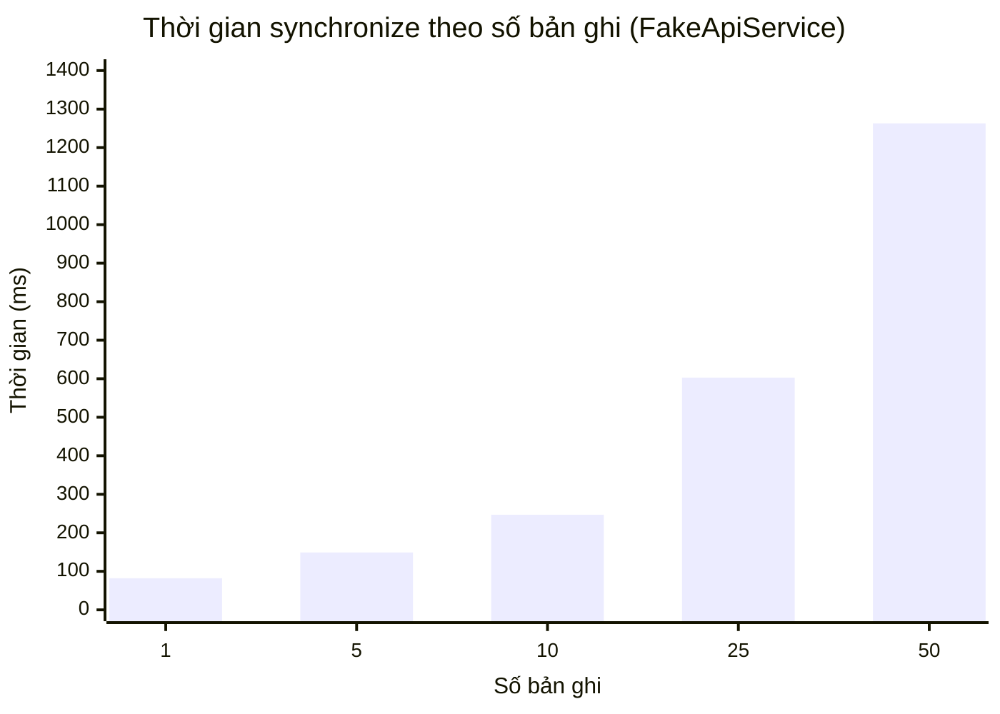

# D7. Báo cáo thực nghiệm và đánh giá

## 1. Mục tiêu

Báo cáo đánh giá thời gian đồng bộ theo kích thước dữ liệu, tỷ lệ thành công khi có lỗi mạng giả lập, tính idempotent khi gửi lại mutation, tính nhất quán dữ liệu và các giới hạn của phép thử. Kết quả được chia rõ giữa số đo thực nghiệm đã chạy và các phép đo triển khai thật chưa thực hiện.

## 2. Môi trường và phương pháp

| Hạng mục | Môi trường/phương pháp |
|---|---|
| Thiết bị chạy Android test | Android Emulator `Medium_Phone(AVD) - 17`, Google `sdk_gphone16k_x86_64`, API 37 |
| Ứng dụng | Variant `debug`; Android instrumentation test |
| Lưu trữ trong phép đo Android | Room in-memory database |
| API trong phép đo Android | `FakeApiService`; không có độ trễ mạng/server thật |
| Dữ liệu | Movement tổng hợp; ID `m1...mN`, cùng `product-1`, số lượng thay đổi theo bản ghi |
| Lỗi mạng | Giả lập lỗi `IOException` có tính xác định cho 30% lần gọi trong bộ 20 lượt |
| Server integration riêng | Node.js `v24.20.0`, HTTP loopback và SQLite tạm do test tạo |
| Thời điểm chạy nhóm đo | 04/11/2026 |

Nhóm đo Android được chạy riêng bằng lệnh:

```powershell
.\gradlew.bat :app:connectedDebugAndroidTest "-Pandroid.testInstrumentationRunnerArguments.class=com.example.coffeestock.sync.SyncMetricsTest"
```

Ba test đo đều **PASS** (3 pass, 0 fail, 0 skip). XML và logcat đầy đủ đã lưu trong [evidence D7](./evidence/D7/).

## 3. Kết quả đo được

### 3.1. Thời gian đồng bộ theo số bản ghi

Đo thời gian gọi `SyncEngine.synchronize()` gồm push, pull và xử lý Room trên emulator; mỗi kích thước được đo một lần bằng fake API.

| Số bản ghi (N) | Thời gian (ms) | Thời gian/bản ghi (ms) | Kết quả |
|---:|---:|---:|---|
| 1 | 82 | 82.00 | Thành công, đủ 1 bản ghi phía API giả lập |
| 5 | 149 | 29.80 | Thành công, đủ 5 bản ghi |
| 10 | 247 | 24.70 | Thành công, đủ 10 bản ghi |
| 25 | 603 | 24.12 | Thành công, đủ 25 bản ghi |
| 50 | 1263 | 25.26 | Thành công, đủ 50 bản ghi |



Số đo cho thấy tổng thời gian tăng theo kích thước dữ liệu trong cấu hình thử nghiệm. Thời gian/bản ghi ở các lô N=5–50 nằm trong khoảng 24–30 ms; phép đo N=1 là 82 ms/bản ghi. Đây chỉ là một lần đo xử lý trong emulator với API giả lập, **không phải** thời gian round-trip qua mạng hoặc hiệu năng server.

### 3.2. Tỷ lệ thành công khi giả lập lỗi mạng

Thử 20 lượt đồng bộ độc lập, mỗi lượt có một movement. Mẫu lỗi lặp xác định tạo 6 lượt trả `RETRY` và 14 lượt `SUCCESS`.

| Kết quả lượt đầu | Số lượt | Tỷ lệ |
|---|---:|---:|
| `SUCCESS` | 14/20 | 70% |
| `RETRY` do lỗi mạng giả lập | 6/20 | 30% |
| `FAILURE` | 0/20 | 0% |

Phép tính tỷ lệ thành công lượt đầu: `14 / 20 × 100 = 70%`. Sáu lượt `RETRY` không được chạy lại trong phép đo này; vì vậy **70% không phải tỷ lệ phục hồi cuối cùng sau retry**, cũng không đại diện cho tỷ lệ thành công trên mạng thật. Test xác nhận hệ thống nhận diện lỗi tạm thời và yêu cầu retry, không đo độ tin cậy của một lần đồng bộ nhiều lần thử.

### 3.3. Gửi lặp và tính nhất quán

| Kiểm tra | Thao tác | Kết quả đo/kiểm chứng |
|---|---|---|
| Idempotency | Push mutation `m1` một lần, sau đó yêu cầu đồng bộ lại 5 lần với cùng `mutationId` | Server giả lập giữ 1 record; local giữ 1 record |
| Bản ghi trùng | So sánh số record sau các lần gửi lặp với số record kỳ vọng | 0 record trùng |
| Đồng bộ lô | Đồng bộ 20 movement trong `SyncScenarioTest` | API giả lập nhận đủ 20; từng movement được assertion ở trạng thái `SYNCED` |
| Luồng API server | 16 integration tests trên HTTP loopback và SQLite tạm | 16 pass, 0 fail; có kiểm tra version conflict, cursor, tombstone và idempotency |

Với phép đo idempotency, tỷ lệ trùng được tính là `(tổng record - số record duy nhất) / số record duy nhất × 100`; kết quả `(1 - 1) / 1 × 100 = 0%`. Các test consistency còn kiểm tra dữ liệu pending local không bị pull ghi đè và tombstone không làm phiếu đã xóa sống lại; xem chi tiết tại [D6. Bộ kiểm thử và kết quả kiểm thử](./D6_TEST_RESULTS.md).

## 4. Tổng hợp kết quả và phân tích

| Chỉ tiêu | Kết quả hiện có | Diễn giải |
|---|---|---|
| Thời gian đồng bộ cục bộ | 82–1263 ms với N=1–50 | Đo `SyncEngine` + Room in-memory + FakeApiService; không phải thời gian mạng thật |
| Thành công lượt đầu dưới lỗi giả lập | 14/20 = 70% | 6 lượt được yêu cầu `RETRY`; chưa đo kết quả sau khi chạy lại |
| Tỷ lệ test tự động pass trong lần chạy D6 | 83/83 = 100% | Đây là tỷ lệ pass của test suite, không phải tỷ lệ thành công đồng bộ production |
| Mutation trùng trong phép thử idempotency | 0/1 = 0% | Năm lần gọi đồng bộ lại không tạo thêm record trong API giả lập |
| Nhất quán trong test dữ liệu | Các assertion về trạng thái, số record, version/cursor và tombstone đều pass | Chỉ xác nhận các kịch bản test đã viết |
| Đồng bộ qua hạ tầng thật | Chưa đo | Cần chạy server/app trên cùng mạng hoặc hai thiết bị và ghi thời gian thực tế |

Kết quả hỗ trợ nhận định rằng các luồng cốt lõi đã có kiểm thử tự động: ứng dụng giữ thay đổi local, xử lý lỗi tạm thời bằng retry, giữ cùng mutation ID khi retry và không tạo bản ghi trùng trong kịch bản idempotency. Tính nhất quán được xác minh bằng assertion dữ liệu ở Room và API giả lập, cộng với integration tests server.

## 5. Phạm vi tự động hóa và giới hạn

Các phép đo D7 và assertion về dữ liệu chạy tự động; không cần nhập thời gian, số lượt hoặc PASS/FAIL bằng tay. Chạy lại phép đo trên emulator bằng:

```powershell
.\gradlew.bat :app:connectedDebugAndroidTest "-Pandroid.testInstrumentationRunnerArguments.class=com.example.coffeestock.sync.SyncMetricsTest"
```

Test thất bại nếu đồng bộ không thành công, số bản ghi/status không đúng, tỷ lệ mô phỏng không đúng 14 SUCCESS/6 RETRY, hoặc gửi lại mutation làm phát sinh bản ghi trùng. XML lần chạy được tạo tại `app/build/outputs/androidTest-results/connected/debug/` và bản minh chứng lần chạy hiện tại nằm trong [evidence D7](./evidence/D7/).

Các giới hạn cần giữ nguyên khi diễn giải kết quả:

- Thời gian ở mục 3.1 là một lần đo cho mỗi N trên emulator; không có lặp để tính trung bình/độ lệch chuẩn.
- `FakeApiService` loại bỏ độ trễ/jitter/mất gói/DNS/TLS và tải server thật; các số đo không dự đoán hiệu năng Internet.
- Tỷ lệ 70% là kết quả lượt đầu theo mẫu lỗi cố định; sáu lượt `RETRY` không được thử lại trong metric này.
- Kịch bản nhiều thiết bị dùng hai Room database độc lập với fake server, không phải hai thiết bị vật lý.
- Chưa có phép đo end-to-end với backend production, mạng thật, throughput hoặc nhiều client dưới tải. Các kiểm thử UI/video nếu cần là minh chứng trình diễn riêng, không phải bước cần thiết để test logic D7 pass.

## 6. Kết luận

Trong môi trường kiểm thử hiện tại, `SyncEngine` xử lý được lô tổng hợp đến 50 movement với 1263 ms trên emulator + FakeApiService; khi 30% request bị ép lỗi, 14/20 lượt hoàn tất thành công ngay và 6/20 yêu cầu retry. Thử gửi lại cùng mutation ID năm lần cho kết quả 1 record, 0 record trùng. Các kiểm tra consistency liên quan đều pass trong các test suite đã chạy.

Các kết quả này là minh chứng cho logic đồng bộ trong môi trường kiểm thử, **chưa phải đánh giá hiệu năng hoặc độ tin cậy trên hạ tầng triển khai thật**. Cần bổ sung phép đo end-to-end, lặp nhiều lần, kiểm thử phục hồi mạng thật và ghi nhận hai thiết bị hội tụ trước khi đưa ra kết luận định lượng về môi trường sử dụng thực tế.

## 7. Minh chứng

- [XML kết quả ba test đo](./evidence/D7/TEST-Medium_Phone-AVD-17.xml)
- [Logcat đo thời gian theo số bản ghi](./evidence/D7/logcat-com.example.coffeestock.sync.SyncMetricsTest-metric1_syncTimeByDataSize.txt)
- [Logcat tỷ lệ thành công khi giả lập lỗi](./evidence/D7/logcat-com.example.coffeestock.sync.SyncMetricsTest-metric2_successRate_30PercentFailure.txt)
- [Logcat thử idempotency/gửi lặp](./evidence/D7/logcat-com.example.coffeestock.sync.SyncMetricsTest-metric3_duplicateRate_idempotency.txt)
- [Báo cáo test cases và kết quả D6](./D6_TEST_RESULTS.md)
- [Mã nguồn các phép đo](../app/src/androidTest/java/com/example/coffeestock/sync/SyncMetricsTest.kt)
- [Mã nguồn đo đồng bộ lô 20 movement](../app/src/androidTest/java/com/example/coffeestock/sync/SyncScenarioTest.kt)
